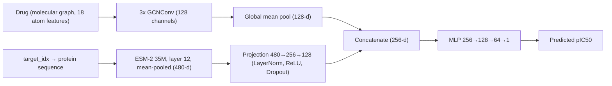

# DTI-GNN: Cold-Start Drug–Target Affinity Prediction on BindingDB

**Final Project Report** — data preparation, cold-start split design, model development (v1 → v2 → v3), and evaluation.

> **Task:** predict pIC50 for a (drug, protein target) pair, with an emphasis on **cold-start generalization** — drugs, targets, or both that were never seen during training.

---

## Table of Contents

1. [Summary](#1-summary)
2. [Problem Definition](#2-problem-definition)
3. [Data Preparation](#3-data-preparation)
4. [Cold-Start Split Design](#4-cold-start-split-design)
5. [Model Development](#5-model-development)
6. [The v3 Numerical Instability Incident](#6-the-v3-numerical-instability-incident)
7. [Results](#7-results)
8. [Analysis and Discussion](#8-analysis-and-discussion)
9. [Limitations](#9-limitations)
10. [Future Work](#10-future-work)
11. [Reproducibility and Repository Layout](#11-reproducibility-and-repository-layout)
12. [Known Inconsistencies and Open Items](#12-known-inconsistencies-and-open-items)
13. [References](#13-references)

---

## 1. Summary

| Item | Value |
|---|---|
| Data source | BindingDB (human targets, IC50 endpoint) |
| Regression target | pIC50 = 9 − log10(IC50 in nM) |
| Cleaned dataset | 998,586 unique drug–target pairs (median pIC50 per pair) |
| Unique drugs / targets | 687,561 InChIKeys / 3,914 target names |
| Split strategy | Murcko-scaffold split for drugs + grouped split for targets → `train`, `cold_drug`, `cold_target`, `cold_pair` |
| Model family | Two-tower: 3-layer GCN (drug) + ESM-2 35M (target) → concatenate → MLP → pIC50 |
| Versions | v1 (baseline) → v2 (deeper target MLP) → v3 (range-weighted loss, live ESM, stabilised normalization) |

**Key findings**

- **New drugs are much easier than new targets.** In every version, cold-drug Pearson *r* (≈0.55–0.65) is far higher than cold-target *r* (≈0.22–0.30).
- **Deepening the target network (v2) did not help new-target generalization** (cold-target *r*: 0.300 → 0.297), which pointed to the frozen ESM-2 representation as the bottleneck.
- **The first v3 run produced exploding predictions** (thousands to tens of thousands) caused by degenerate BatchNorm running statistics in the target projection. Replacing BatchNorm with LayerNorm fixed the output scale.
- **The corrected v3 (“stable”) model did not improve on v1/v2 in correlation** on any cold-start split (cold-target *r* = 0.222). The v3 hypothesis — that adapting ESM and up-weighting rare extremes would raise new-target performance — was **not supported** by the measured results (see [§8](#8-analysis-and-discussion) for caveats on comparability).
- **High-potency compounds (pIC50 ≥ 9) remain poorly predicted**; predictions regress toward the mean and the training data contains very few such examples (739 in 10.5–12, 27 above 12).

---

## 2. Problem Definition

A drug can bind a protein target with a certain potency. IC50 is the concentration needed to reduce a biological activity by 50%; **pIC50** is its negative base-10 logarithm in molar units, so a higher pIC50 means a more potent compound.

The model takes:

- **Drug** → molecular graph (atoms = nodes, bonds = edges)
- **Target** → protein amino-acid sequence, embedded with the protein language model ESM-2

and outputs a single scalar: the predicted pIC50.

**Why cold-start?** A random row-level split lets the same drug or protein appear in both train and test, so a model can score well by memorizing entities. Cold-start evaluation measures generalization to genuinely new molecules, new proteins, and both.

---

## 3. Data Preparation

### 3.1 Pipeline

| # | Step | Purpose | Outcome |
|---|---|---|---|
| 1 | BindingDB selection | Source of experimental drug–target affinities | BindingDB chosen |
| 2 | Chunked TSV processing | The extracted TSV is multi-GB; avoid loading it fully into RAM (Colab) | Chunked pandas reading |
| 3 | Initial filtering | Keep human targets with drug, target, and affinity information | **2,477,542** records |
| 4 | IC50 selection | Use one consistent endpoint rather than mixing Ki/Kd/IC50/EC50 | **1,718,393** IC50 records (≈69.4%) |
| 5 | Remove censored values | Strings like `>50000`, `<5` cannot be log-transformed as exact values | **1,342,383** numeric records (376,010 removed) |
| 6 | Extreme-value inspection | Detect invalid/extreme values before the log transform | 118 values ≤ 0; 4,181 values > 1,000,000 nM |
| 7 | Working range | Keep 0 < IC50 ≤ 1 mM | **1,338,084** records |
| 8 | pIC50 conversion | Log scale suitable for regression | pIC50 range 3.00–13.30, median 6.74, mean 6.80 |
| 9 | Duplicate-pair analysis | Repeated measurements risk leakage under row-level splits | 998,586 unique pairs; 201,287 pairs repeated (540,785 records) |
| 10 | Pair aggregation | One label per pair; median is robust to outliers | **998,586** rows, with `Num_Measurements` retained |
| 11 | Drug identity check | Cold-start requires splitting by drug identity | 687,561 unique InChIKeys; 26 pairs lack an InChIKey; all have SMILES |
| 12 | SMILES canonicalization | Check whether multiple SMILES per InChIKey are the same structure | 4,506 drugs have multiple SMILES (4,320 with 2; 162 with 3; 17 with 4; 4 with 5; 3 with 6) |

### 3.2 Dataset funnel

```
2,477,542  filtered BindingDB records
1,718,393  with IC50
1,342,383  numeric IC50 (censored values removed)
1,338,084  after range filter (0 < IC50 ≤ 1 mM)
  998,586  unique drug–target pairs (median pIC50)
```

### 3.3 Design notes

- **IC50 only.** Combining Ki, Kd, IC50, and EC50 would mix biologically different quantities.
- **Censored values are dropped**, not imputed (see [Limitations](#9-limitations)).
- **Median aggregation** gives each pair one label so repeated measurements are not treated as independent examples.
- Canonicalization was prepared as an inspection step; no records were deleted on that basis at the time of the data-preparation report.

---

## 4. Cold-Start Split Design

The cleaned file (`BindingDB_final_clean.csv`, 997,553 rows × 11 columns) was split so that drug-side and target-side generalization can be measured separately.

### 4.1 Procedure

1. **Murcko scaffolds** (RDKit) computed from `Canonical_SMILES`; all rows produced a valid scaffold (264,650 unique scaffolds initially).
2. **Drug split:** scaffold groups sorted by size and greedily assigned to train/test until ~20% of rows were reserved for test.
3. **Target split:** `Target_Name` values randomly grouped, holding out ~15% of target groups (3,327 train targets / 587 test targets).
4. **Four quadrants** built from the combined flags:

| Split | Drug | Target | Purpose |
|---|---|---|---|
| `train` | seen | seen | Model training |
| `cold_drug` | **new** | seen | Generalization to new molecules |
| `cold_target` | seen | **new** | Generalization to new proteins |
| `cold_pair` | **new** | **new** | Hardest setting |

### 4.2 Leakage bug found and fixed

The first leakage check found **904 `cold_drug` rows and 175 `cold_pair` rows** whose drug (by InChIKey) also appeared in train. Cause: **2,070 drugs mapped to more than one scaffold**, mostly minor SMILES variants of the same molecule.

**Fix:** each drug was assigned a single *primary* scaffold (its most frequent) before re-splitting. After re-splitting (263,585 unique scaffolds), all four leakage checks returned **0**.

### 4.3 Final split sizes

| Split | Rows | % of total |
|---|---:|---:|
| train | 653,383 | 65.5% |
| cold_drug | 161,565 | 16.2% |
| cold_target | 144,614 | 14.5% |
| cold_pair | 37,991 | 3.8% |

Leakage verification (final): cold_drug rows with drug in train = **0**; cold_target rows with target in train = **0**; cold_pair rows with drug in train = **0**; cold_pair rows with target in train = **0**.

> **Caveat:** targets were grouped by *exact name*, which does not separate close protein-family relatives (e.g., EGFR and ErbB-2). Clustering by sequence identity would be a stricter test.

---

## 5. Model Development

All versions share a **two-tower** design: the drug and the target are encoded separately and combined only at the end, so the model does not depend on having seen prior interactions of a given entity.

### 5.1 v1 — Baseline

| Component | Description |
|---|---|
| Drug tower | Molecular graph → 3-layer GCN → mean-pool over atoms → 128-d vector |
| Target tower | Protein sequence → **frozen** ESM-2 (`esm2_t12_35M`) → 480-d embedding → Linear + ReLU → 128-d |
| Fusion | Concatenate 128-d drug + 128-d target |
| Head | Small MLP → scalar pIC50 |
| Training | 10 epochs, MSE loss; train MSE 1.81 → 1.21 (still decreasing) |

ESM-2 35M was chosen for speed on a single Colab GPU. Protein embeddings were computed once and cached.

### 5.2 v2 — Deeper target network

**Hypothesis:** the target projection after ESM is too small to extract useful structure.

| Component | v1 | v2 |
|---|---|---|
| Target projection | Linear + ReLU, 480 → 128 | MLP 480 → 256 → 128 with BatchNorm + Dropout |
| LR control | — | `ReduceLROnPlateau` |
| Epochs | 10 | 30 |
| ESM | Frozen | Frozen |

Final train MSE fell to 0.9672 (still decreasing). Training fit improved, but new-target generalization did not (see [§7](#7-results)). Reasoning: v2 increased *capacity* but not the *information* in the input, since the frozen ESM embedding was unchanged.

### 5.3 v3 — Task-adapted target representation + range-weighted loss

Planned changes to address the two diagnosed limitations:

| Problem observed in v2 | v3 change | Rationale |
|---|---|---|
| Cold-target performance flat | Compute ESM live from raw sequences (`target_idx` + sequence) and allow ESM to adapt to the DTI task | Cached frozen embeddings cannot adapt |
| Rare extreme pIC50 values poorly predicted (accuracy within ±1.0 only 0.5–5.3% for pIC50 ≥ 8) | **Range-weighted squared-error loss** (inverse-square-root label-bin weights) | Give rare high/low-potency examples more gradient signal |
| Repeated ESM computation per batch | Target-grouped batches + `torch.unique` / project each unique target once | Run ESM once per distinct protein per batch |

The v3 data format stores `target_idx` (an integer into a fixed target vocabulary) plus access to raw sequences instead of a precomputed `target_emb`, because a cached embedding would go stale as ESM weights change.

Expected trade-offs: higher compute and memory cost (ESM in the live computation graph) and possibly slightly worse overall RMSE/MAE in the dense middle range due to weighting.

### 5.4 v3 stable (architecture version 2) — final model

After the instability described in [§6](#6-the-v3-numerical-instability-incident), the model was redefined in a shared module (`model_v3.py`) used by training, evaluation, and diagnostics.

| Component | Behavior |
|---|---|
| Drug encoder | 3 × `GCNConv` (18 atom features → 128 hidden channels), global mean pooling |
| Target encoder | ESM-2 35M layer-12 residue representations, mean-pooled per protein (480-d) |
| Target projection | 480 → 256 → 128 with **LayerNorm**, ReLU, dropout — **no BatchNorm running statistics** |
| Repeated targets | Project each unique target once, then map back to examples |
| Fusion / head | Concatenate 128-d drug + 128-d target → MLP 256 → 128 → 64 → 1 |
| Loss | Range-weighted squared error (inverse-square-root label-bin weights) |
| Training | 15 epochs, target-grouped batches, non-finite output checks |
| Checkpoint | `dti_model_v3_stable_epoch15.pt` (architecture version recorded in metadata) |



---

## 6. The v3 Numerical Instability Incident

**Symptom.** The first v3 checkpoint (`dti_model_v3_epoch15.pt`) produced predictions in the **thousands to tens of thousands**, while true labels were roughly 5–8.

**Ruled out.** A pIC50-vs-nM unit mix-up: the inspected training labels were already on a plausible pIC50 scale (≈3.0–12.7).

**Root cause.**

| Evidence | Meaning |
|---|---|
| First target-projection BatchNorm layer had running variance of exactly **0.0** in all channels; the next layer's was extremely small | Inference-time normalization was degenerate |
| Training batches were grouped by target, and the encoder expanded one protein embedding to many duplicate examples before BatchNorm | Batch statistics were computed over duplicated vectors, producing degenerate running statistics |
| At evaluation, unseen protein representations were divided by a near-zero standard deviation | Activations amplified → huge predictions |

**Fix.** Replace BatchNorm with **LayerNorm** in the target projection, project each unique target once, and move the shared model definition into `model_v3.py`. The GNN and prediction head were not fundamentally redesigned. Old checkpoints were preserved; stable checkpoints use the prefix `dti_model_v3_stable_epoch*.pt`.

**Guards added.** `evaluate_v3.py` checks checkpoint architecture compatibility and aborts if predictions are non-finite or exceed an absolute magnitude of 20.

> Fixing the output scale makes predictions plausible; it does **not** by itself show the model predicts unseen interactions accurately.

---

## 7. Results

### 7.1 Cold-start metrics by version

Metrics are on the pIC50 scale. “—” = not reported in the source material.

**Pearson r**

| Split | v1 | v2 | v3 stable |
|---|---:|---:|---:|
| cold_drug | 0.5816 | 0.654 | 0.5528 |
| cold_target | 0.2997 | 0.297 | 0.2223 |
| cold_pair | 0.3600 | 0.321 | 0.2357 |

**RMSE**

| Split | v1 | v2 | v3 stable |
|---|---:|---:|---:|
| cold_drug | 1.1551 | 1.254 | 1.4835 |
| cold_target | 1.3216 | 1.587 | 1.8930 |
| cold_pair | 1.2783 | 1.545 | 1.8355 |

**MAE**

| Split | v1 | v2 | v3 stable |
|---|---:|---:|---:|
| cold_drug | 0.8806 | — | 1.2105 |
| cold_target | 1.0529 | — | 1.5363 |
| cold_pair | 1.0131 | — | 1.4740 |

### 7.2 v3 stable — full report (epoch 15)

| Split | N | RMSE | MAE | Pearson r | Within ±1.0 |
|---|---:|---:|---:|---:|---:|
| Cold-drug | 138,556 | 1.4835 | 1.2105 | 0.5528 | 47.05% |
| Cold-pair | 31,839 | 1.8355 | 1.4740 | 0.2357 | 41.58% |
| Cold-target | 123,438 | 1.8930 | 1.5363 | 0.2223 | 38.93% |

### 7.3 Error by actual pIC50 bin (v3 stable, MAE)

| Actual pIC50 bin | Train examples | Cold-drug | Cold-pair | Cold-target |
|---|---:|---:|---:|---:|
| 7.5–9.0 | 143,839 | 1.895 | 2.514 | 2.517 |
| 9.0–10.5 | 23,997 | 2.742 | 3.670 | 3.769 |
| 10.5–12.0 | 739 | 3.630 | 5.520 | 5.442 |
| 12.0–13.5 | 27 | not present | 6.439 (n=5) | 7.033 (n=3) |

Errors grow sharply with actual potency, and predictions regress toward the middle, especially for cold-target and cold-pair. Test counts above 12 are only 3–5, so those figures are highly uncertain.

### 7.4 Earlier diagnosis (v1/v2)

- Performance was strongest in the dense middle of the label distribution (pIC50 ≈ 4.5–7.5, about two-thirds of training examples).
- For pIC50 ≥ 8, accuracy within ±1.0 pIC50 was only **0.5–5.3%** across the three splits.

---

## 8. Analysis and Discussion

**1. The target side is the main generalization gap.** Across all versions, unseen drugs are predicted with moderate correlation (*r* ≈ 0.55–0.65), while unseen targets sit near *r* ≈ 0.22–0.30. A single target-name-grouped split also means the model sees only ~3,300 distinct proteins in training, which limits how well it can learn target-side structure.

**2. Capacity was not the bottleneck (v1 → v2).** A deeper target MLP and 3× longer training lowered training error but left cold-target correlation unchanged (0.300 → 0.297) and worsened cold-target RMSE (1.32 → 1.59). Correlation can improve while RMSE worsens because the two measure different things (trend alignment vs. size of errors).

**3. The corrected v3 did not realize its expected gains.** The roadmap expected cold-target and cold-pair correlation to rise meaningfully above ~0.30 and cold-drug to hold steady or improve. The measured stable-v3 results show the opposite: *r* is lower than v1 on all three splits, and RMSE/MAE are higher. A rise in overall RMSE/MAE was anticipated as a cost of weighted loss, but the drop in correlation was not.

**Caveats when comparing v3 to v1/v2:**

- v3 changed several things at once (live ESM, LayerNorm replacing BatchNorm, range-weighted loss, target-grouped batches, 15 epochs), so the result cannot be attributed to any single change without ablations.
- Evaluation sets for v3 (e.g., cold-target N = 123,438) are smaller than the split files (144,614 rows); the evaluation sample sizes for v1/v2 are not stated, so the comparison may not be on identical rows.
- The source material does not restate which ESM layers were trainable in the final stable run; confirm this before claiming the result tests “partial fine-tuning.”

**4. Weighting cannot replace data diversity.** The highest populated bins already receive large weights, but only 739 training examples fall in 10.5–12 and 27 above 12. Acquiring more quality-controlled high-pIC50 examples across diverse drugs and targets is likely more valuable than further reweighting.

**5. Don't tune on the cold-start test sets.** No validation split was defined. Any further hyperparameter or architecture changes should be assessed on a separate target-held-out validation set.

---

## 9. Limitations

- **No validation set.** Train and the three cold-start test sets only; the epoch-15 checkpoint was not selected on held-out validation data.
- **Target grouping by exact name**, not sequence identity — close homologs may straddle train and test, making cold-target results potentially optimistic, yet still weak.
- **Censored IC50 values removed** (376,010 records, e.g., `>50000`). This discards "inactive" information and biases the label distribution toward measurable potency. Values above 1 mM were also removed.
- **IC50 is assay-dependent.** Median aggregation reduces noise but does not remove inter-assay variability; `Num_Measurements` was retained but its use as a weight or filter was not explored.
- **Severe label imbalance at high potency** (see [§7.3](#73-error-by-actual-pic50-bin-v3-stable-mae)); metrics above pIC50 12 rest on 3–5 test examples.
- **Small protein encoder.** ESM-2 35M (480-d) was chosen for single-GPU speed; larger variants were not tested.
- **Drug representation is a 2D graph** with 18 atom features; no 3D, bond-type, or interaction-level information is documented.
- **Single run per version;** no seeds, confidence intervals, or significance tests are reported.
- **In-sample diagnostic only for training fit.** The stratified 256-sample training diagnostic measures fit on training data and over-represents rare high bins; it must not be compared with cold-start metrics.

---

## 10. Future Work

1. **Target-held-out validation split**, with performance reported by pIC50 bin and split type.
2. **Sequence-identity clustering** (e.g., by homology thresholds) for the target split.
3. **Ablations** isolating each v3 change: frozen ESM + LayerNorm; + range-weighted loss; + partial ESM fine-tuning.
4. **Identical-row comparison** of v1, v2, and v3 on the same evaluation sets.
5. **More high-pIC50 data** across diverse drugs and targets; QC for potential outliers.
6. **Censored-data handling** (e.g., censored-regression loss) instead of dropping `>`/`<` records.
7. **Larger or alternative protein encoders** and richer drug featurization.
8. **Uncertainty estimates** and multiple seeds.
9. Run the **training-sample diagnostic** (`evaluate_train_sample_v3.py`) on the GPU checkpoint if an in-sample fit check is desired (the script was tested for sampling and identifiers but not run against the checkpoint).

---

## 11. Reproducibility and Repository Layout

### 11.1 Files produced by the project

| File | Purpose |
|---|---|
| `model_v3.py` | Shared stable (architecture v2) model definition |
| `train_v3.py` | Training loop; stable checkpoint creation |
| `evaluate_v3.py` | Cold-start evaluation; report/CSV/NPZ output |
| `evaluate_train_sample_v3.py` | Stratified in-sample diagnostic (256 samples, seed 42) |
| `checkpoints/dti_model_v3_stable_epoch15.pt` | Trained weights + metadata |
| `data/target_sequences.pkl` | Protein sequences for the ESM target encoder |
| `data/target_to_idx.pkl` | Target index ↔ UniProt mapping |
| `data/train_data_v2.pt` + split files | Training and evaluation graph datasets |
| `split_train.csv`, `split_cold_drug.csv`, `split_cold_target.csv`, `split_cold_pair.csv` | Cold-start split tables |

Diagnostic outputs: `train_sample_v3_report.txt`, `train_sample_v3_predictions.csv`, `train_sample_v3_predictions.npz`. Each diagnostic row carries the target UniProt accession; because the saved graph dataset has no SMILES/name, drug identity is a SHA-256 fingerprint of the stored graph.

### 11.2 Suggested repository structure

```
.
├── README.md                  # short overview, link to PROJECT_REPORT.md
├── PROJECT_REPORT.md          # this document
├── src/
│   ├── model_v3.py
│   ├── train_v3.py
│   ├── evaluate_v3.py
│   └── evaluate_train_sample_v3.py
├── data_prep/                 # BindingDB filtering, pIC50, aggregation, split notebooks/scripts
├── reports/                   # evaluation outputs (txt/csv)
├── checkpoints/               # use Git LFS or release assets, not plain git
└── data/                      # not committed; provide download/build instructions
```

### 11.3 Notes before publishing

- The **weights file alone is not enough** — keep code, checkpoint, protein sequences, and compatible **PyTorch, PyTorch Geometric, and ESM** versions together; pin versions in `requirements.txt`.
- Evaluation scripts currently read split data from a local Windows path (`C:\DTI_GNN\evaluation`). Replace with a configurable/relative path before release.
- Large files (checkpoints, graph datasets, split CSVs) should go through Git LFS, GitHub Releases, or external storage.
- Check BindingDB's license/terms before redistributing any derived data.

### 11.4 Validation performed

Automated tests passed for finite target-encoder outputs with repeated proteins, a GNN forward/backward pass, reproducible stratified sampling that includes rare high scores, and stable graph fingerprints; Python files were syntax-compiled. Evaluation metrics in this report are transcribed from the local evaluation report; the model was not retrained as part of preparing this document.

---

## 12. Known Inconsistencies and Open Items

These come from comparing the project documents and should be resolved (or the section removed) before publishing.

| Item | Detail |
|---|---|
| Row-count difference | Data-prep report: **998,586** pair rows. Split file: **997,553** rows (`BindingDB_final_clean.csv`). The 1,033-row gap is not explained in the source material (possibly later cleaning, e.g., missing InChIKeys or SMILES canonicalization). |
| Evaluation vs. split sizes | Split files: cold_drug 161,565 / cold_target 144,614 / cold_pair 37,991. v3 evaluation N: 138,556 / 123,438 / 31,839. The reason for the reduction (e.g., missing sequences, invalid graphs) is not documented. |
| Canonicalization outcome | The data-prep report lists RDKit canonicalization as pending; the split uses `Canonical_SMILES`, but the final decision/outcome is not recorded. |
| 26 missing InChIKeys | Listed as a to-do; resolution not documented. |
| ESM trainable layers in stable run | The v3 plan states the last transformer block is trainable; the architecture-correction document does not restate it. Confirm. |
| v1/v2 evaluation sizes and v2 MAE | Not reported, limiting like-for-like comparison with v3. |
| Dropout / learning-rate / batch-size values | Not specified in the source material; add from training code for full reproducibility. |

---

## 13. References

- Gilson, M. K., et al. (2016). **BindingDB in 2015: A public database for medicinal chemistry, computational chemistry and systems pharmacology.** *Nucleic Acids Research*, 44(D1), D1045–D1053.
- Lin, Z., et al. (2023). **Evolutionary-scale prediction of atomic-level protein structure with a language model.** *Science*, 379(6637), 1123–1130. (ESM-2)
- Kipf, T. N., & Welling, M. (2017). **Semi-supervised classification with graph convolutional networks.** *ICLR*.
- Bemis, G. W., & Murcko, M. A. (1996). **The properties of known drugs. 1. Molecular frameworks.** *Journal of Medicinal Chemistry*, 39(15), 2887–2893.
- RDKit: open-source cheminformatics. https://www.rdkit.org
- PyTorch Geometric. https://pytorch-geometric.readthedocs.io
