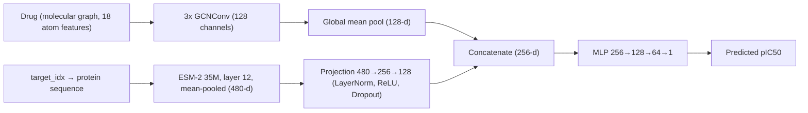

# Cold-Start Drug–Target Interaction Prediction

Predicting drug–target binding affinity (**pIC50**) on **BindingDB** in the **cold-start** setting, where the drugs, the targets, or both were never seen during training.

A two-tower graph neural network encodes the drug with a **GCN** and the protein with a **partially fine-tuned ESM-2** language model, trained with a **range-weighted loss** aimed at rare, extreme affinities.

> 📄 Full methodology, results, and discussion: **[PROJECT_REPORT.md](PROJECT_REPORT.md)**

---

## Highlights

- **Dataset:** 998,586 unique drug–target pairs from BindingDB (human targets, IC50 → pIC50, median over repeated measurements)
- **Leakage-checked cold-start splits:** Murcko-scaffold split for drugs + grouped split for targets, giving four evaluation sets: `train`, `cold_drug`, `cold_target`, `cold_pair`
- **Model:** two-tower architecture — 3-layer GCN (drug) + ESM-2 35M (target) → concatenation → MLP → pIC50
- **Training objective:** range-weighted squared error (inverse-square-root label-bin weights)
- **Documented debugging:** a BatchNorm failure that caused exploding predictions, diagnosed and fixed with LayerNorm
- **Honest evaluation:** results reported separately per cold-start split, with error broken down by pIC50 bin

---

## Task

**Input:** a drug (molecular graph) and a protein target (amino-acid sequence)
**Output:** one number — the predicted pIC50 (higher = more potent)

`pIC50 = 9 − log10(IC50 in nM)`

Cold-start evaluation asks whether the model generalizes to entities it has not seen:

| Split | Drug | Target | What it tests |
|---|---|---|---|
| `train` | seen | seen | Model fitting |
| `cold_drug` | **new** | seen | Generalization to new molecules |
| `cold_target` | seen | **new** | Generalization to new proteins |
| `cold_pair` | **new** | **new** | Hardest setting |

---

## Method



| Component | Details |
|---|---|
| Drug encoder | 3 × `GCNConv`, global mean pooling → 128-d |
| Target encoder | ESM-2 `esm2_t12_35M`, residue representations mean-pooled → 480-d, partially fine-tuned in v3 |
| Target projection | 480 → 256 → 128, LayerNorm + ReLU + dropout |
| Repeated targets | Each unique target in a batch is encoded once, then mapped back to its examples |
| Loss | Range-weighted squared error |

### Model versions

| Version | Change | Outcome |
|---|---|---|
| **v1** | Baseline two-tower, frozen ESM-2, single linear target projection | Decent on new drugs, weak on new targets |
| **v2** | Deeper target MLP, 30 epochs, LR scheduler, frozen ESM-2 | Better training fit; no gain on new targets |
| **v3** | Live ESM-2 from raw sequences, range-weighted loss, target-grouped batches | First run produced exploding predictions (BatchNorm); fixed with LayerNorm (“v3 stable”) |

---

## Data and Splits

1. BindingDB TSV filtered to human targets with affinity data (2,477,542 records), processed in chunks
2. IC50 selected as a single consistent endpoint; censored values (`>`, `<`) and values ≤ 0 or > 1 mM removed → 1,338,084 records
3. IC50 converted to pIC50; repeated drug–target measurements aggregated by **median** → 998,586 pairs
4. Scaffold-based drug split + grouped target split; each drug assigned a single primary scaffold after a leakage bug was found and fixed

| Split | Rows | Share |
|---|---:|---:|
| train | 653,383 | 65.5% |
| cold_drug | 161,565 | 16.2% |
| cold_target | 144,614 | 14.5% |
| cold_pair | 37,991 | 3.8% |

All leakage checks (drug or target appearing in both train and test) return **0**.

> **Note:** targets are grouped by exact name, not sequence identity, so close homologs (e.g., EGFR and ErbB-2) can fall on opposite sides of the split.

Details: [PROJECT_REPORT.md §3–4](PROJECT_REPORT.md).

---

## Results

Metrics are on the pIC50 scale, evaluated separately on each cold-start split.

### v3 stable (epoch 15)

| Split | N | RMSE | MAE | Pearson r | Within ±1.0 |
|---|---:|---:|---:|---:|---:|
| Cold-drug | 138,556 | 1.4835 | 1.2105 | 0.5528 | 47.05% |
| Cold-pair | 31,839 | 1.8355 | 1.4740 | 0.2357 | 41.58% |
| Cold-target | 123,438 | 1.8930 | 1.5363 | 0.2223 | 38.93% |

### Pearson r across versions

| Split | v1 | v2 | v3 stable |
|---|---:|---:|---:|
| cold_drug | 0.582 | 0.654 | 0.553 |
| cold_target | 0.300 | 0.297 | 0.222 |
| cold_pair | 0.360 | 0.321 | 0.236 |

### Takeaways

- **New drugs are easier than new targets** in every version.
- **A deeper target network (v2) did not help unseen targets**, pointing to the frozen ESM-2 representation as the bottleneck.
- **v3 stable did not improve correlation over v1/v2** on the cold-start splits, so the hypothesis that partial ESM fine-tuning plus weighted loss would raise new-target performance is not supported by these results. v3 changed several things at once, and its evaluation sets are smaller than the split files, so the comparison is not strictly like-for-like (see the report for caveats).
- **High-potency compounds remain hard.** Errors grow sharply with pIC50 (cold-target MAE ≈ 2.5 for pIC50 7.5–9 and ≈ 5.4 for 10.5–12), and the training set contains only 739 examples in 10.5–12 and 27 above 12.

---

## Repository Structure

> Adjust to match your repository.

```
.
├── README.md
├── PROJECT_REPORT.md
├── model_v3.py                       # shared model definition (stable architecture)
├── train_v3.py                       # training loop, stable checkpoints
├── evaluate_v3.py                    # cold-start evaluation, report/CSV/NPZ output
├── evaluate_train_sample_v3.py       # stratified in-sample diagnostic
├── checkpoints/
│   └── dti_model_v3_stable_epoch15.pt
└── data/
    ├── target_sequences.pkl          # protein sequences for ESM
    ├── target_to_idx.pkl             # target index ↔ UniProt mapping
    └── train_data_v2.pt              # training graph dataset (+ split files)
```

---

## Getting Started

### Requirements

- Python 3.9+
- [PyTorch](https://pytorch.org/) and [PyTorch Geometric](https://pytorch-geometric.readthedocs.io/)
- ESM-2 (e.g., the [`fair-esm`](https://github.com/facebookresearch/esm) package)
- [RDKit](https://www.rdkit.org/), pandas, NumPy

Pin the exact versions you used in `requirements.txt`. The checkpoint, model code, and protein sequences must stay together; the weights file alone does not contain the model implementation.

### Data

The dataset is **not** included in this repository.

1. Download the BindingDB TSV from [bindingdb.org](https://www.bindingdb.org/) and check its license terms.
2. Filter to human targets, keep numeric IC50 values in the range 0 < IC50 ≤ 1 mM, convert to pIC50, and aggregate repeated pairs by median.
3. Build the cold-start splits (scaffold-based drug split, grouped target split) and convert molecules to graphs.

See [PROJECT_REPORT.md](PROJECT_REPORT.md) for the exact procedure and counts at each step.

### Train

```bash
python train_v4.py
```

The recommended experiment uses frozen ESM-2 150M with cached CLS-plus-mean target embeddings, a deterministic target-held-out validation split, training-only label standardization, and early stopping on validation MAE. It requires CUDA. Install a CUDA-enabled PyTorch build that matches your system before installing the remaining packages with `pip install -r requirements.txt`. The `fair-esm` package provides the Python module; it does not include the pretrained ESM-2 weights. If the target embedding cache is missing, `train_v4.py` downloads those weights once to generate the cache. Subsequent runs reuse the cache. The cache and validation split are created under `data/`; checkpoints are saved as `checkpoints/dti_model_v4_best.pt` and `checkpoints/dti_model_v4_last.pt`. Epochs continue until validation MAE has not improved by 0.001 pIC50 for eight consecutive epochs. The final cold-start test splits are not used for checkpoint selection.

The 15% validation holdout is by target ID, not sequence cluster, so related protein sequences may occur on both sides. The fixed split is recorded in `data/v4_target_validation_split.json`; the ESM cache is `data/esm2_t30_150M_cls_mean_embeddings.pt`. Both are local generated artifacts and can be regenerated on a different machine.

### Evaluate

```bash
python evaluate_v4.py
```

Metrics and predictions are written to `evaluation/v4_results/`. The earlier v3 scripts remain available for reproducing the previous results.

### In-sample diagnostic (optional)

```bash
python evaluate_train_sample_v3.py
```

Evaluates a stratified sample of 256 **training** examples (seed 42) and writes `train_sample_v3_report.txt`, `.csv`, and `.npz`. This is an in-sample fit check, not a measure of generalization, and it must not be compared with the cold-start metrics.

---

## Limitations

- The v4 target holdout is by ID, not sequence cluster
- Target split by name rather than sequence identity
- Censored IC50 values (`>`, `<`) were dropped rather than modeled
- IC50 varies across assays; median aggregation reduces but does not remove this noise
- Very few high-pIC50 training examples; metrics above pIC50 12 rest on 3–5 test examples
- Small protein encoder (ESM-2 35M) and a 2D drug graph only
- Single training run per version; no confidence intervals

## Future Work

- Sequence-identity clustering for the target split
- Ablations separating frozen ESM size/pooling, fusion, and regression loss
- Like-for-like comparison of v1, v2, and v3 on identical evaluation rows
- More quality-controlled high-pIC50 data
- Censored-regression loss, larger protein encoders, and uncertainty estimates

---

## References

- Gilson, M. K., et al. (2016). BindingDB in 2015. *Nucleic Acids Research*, 44(D1), D1045–D1053.
- Lin, Z., et al. (2023). Evolutionary-scale prediction of atomic-level protein structure with a language model. *Science*, 379(6637), 1123–1130.
- Kipf, T. N., & Welling, M. (2017). Semi-supervised classification with graph convolutional networks. *ICLR*.
- Bemis, G. W., & Murcko, M. A. (1996). The properties of known drugs. 1. Molecular frameworks. *Journal of Medicinal Chemistry*, 39(15), 2887–2893.

## License

Add a `LICENSE` file and state it here. Check BindingDB's terms before redistributing any derived data.
