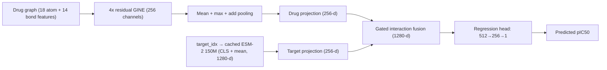

# Cold-Start Drug–Target Interaction Prediction

Predicting drug–target binding affinity (**pIC50**) on **BindingDB** in the **cold-start** setting, where the drugs, the targets, or both were never seen during training.

A two-tower graph neural network encodes the drug with a **bond-aware residual GINE** and the protein with frozen **ESM-2 150M** embeddings. A gated interaction module combines both representations to predict pIC50.


---

## Highlights

- **Dataset:** 998,586 unique drug–target pairs from BindingDB (human targets, IC50 → pIC50, median over repeated measurements)
- **Leakage-checked cold-start splits:** Murcko-scaffold split for drugs + grouped split for targets, giving four evaluation sets: `train`, `cold_drug`, `cold_target`, `cold_pair`
- **Model:** four residual GINE blocks with bond features and mean/max/add pooling; frozen ESM-2 150M; gated drug–target fusion
- **Training objective:** capped inverse-square-root pIC50-bin weighted Smooth L1 with training-only label standardization
- **Training schedule:** AdamW with 10% linear warmup followed by cosine decay
- **Evaluation:** cold-start metrics include MAE, RMSE, Pearson correlation, concordance index, and pIC50-bin breakdowns
- **Documented debugging:** a BatchNorm failure that caused exploding predictions, diagnosed and fixed with LayerNorm
- **Honest evaluation:** results reported separately per cold-start split, with error broken down by pIC50 bin

---

## Task

**Input:** a drug (molecular graph) and a protein target (amino-acid sequence)
**Output:** one number — the predicted pIC50 (higher = more potent)

`pIC50 = 9 − log10(IC50 in nM)`

Cold-start evaluation asks whether the model generalizes to entities it has not seen:

| Split | Drug | Target | What it tests |
|---|---|---|---|
| `train` | seen | seen | Model fitting |
| `cold_drug` | **new** | seen | Generalization to new molecules |
| `cold_target` | seen | **new** | Generalization to new proteins |
| `cold_pair` | **new** | **new** | Hardest setting |

---

## Method



| Component | Details |
|---|---|
| Drug encoder | Atom projection → 4 residual `GINEConv` blocks with directed 14-d bond features |
| Drug pooling | Concatenated global mean, max, and add pooling → 256-d |
| Target encoder | Frozen ESM-2 `esm2_t30_150M`, cached CLS-plus-residue-mean embedding (1280-d) |
| Fusion | Element-wise compatibility, absolute discrepancy, and pair-specific gated mixture |
| Loss | Smooth L1 weighted by inverse square root of training-set pIC50-bin frequency; normalized weights have mean 1 and are capped at 5× between bins |
| Optimizer | AdamW (`5e-5`) with 10% linear warmup and cosine decay |

The v4 graph tensors must include one 14-d `edge_attr` row per directed edge. The feature layout is five bond-type indicators (single, double, triple, aromatic, dative), conjugation, ring membership, six stereo indicators (none, any, Z, E, cis, trans), and a donor-to-acceptor direction flag for dative bonds. Existing graph tensors must be rebuilt before training or evaluation with this architecture.

Loss bins use pIC50 boundaries 4.5, 6, 7.5, 9, 10.5, and 12. Weights are estimated from only the training subset, use capped inverse-square-root bin frequency (maximum 5× before normalization), and are normalized to mean 1. This weights errors on rare high-potency labels more heavily; validation and test metrics remain unweighted.

This revised v4 architecture uses checkpoint revision 7 and writes separate `dti_model_v4_gine_*` checkpoints, leaving earlier v4 checkpoints untouched. Rebuild the training and cold-start graph tensors with the required bond features before starting a new run.

### Model versions

| Version | Change | Outcome |
|---|---|---|
| **v1** | Baseline two-tower, frozen ESM-2, single linear target projection | Decent on new drugs, weak on new targets |
| **v2** | Deeper target MLP, 30 epochs, LR scheduler, frozen ESM-2 | Better training fit; no gain on new targets |
| **v3** | Live ESM-2 from raw sequences, range-weighted loss, target-grouped batches | First run produced exploding predictions (BatchNorm); fixed with LayerNorm (“v3 stable”) |

---

## Data and Splits

1. BindingDB TSV filtered to human targets with affinity data (2,477,542 records), processed in chunks
2. IC50 selected as a single consistent endpoint; censored values (`>`, `<`) and values ≤ 0 or > 1 mM removed → 1,338,084 records
3. IC50 converted to pIC50; repeated drug–target measurements aggregated by **median** → 998,586 pairs
4. Scaffold-based drug split + grouped target split; each drug assigned a single primary scaffold after a leakage bug was found and fixed

| Split | Rows | Share |
|---|---:|---:|
| train | 653,383 | 65.5% |
| cold_drug | 161,565 | 16.2% |
| cold_target | 144,614 | 14.5% |
| cold_pair | 37,991 | 3.8% |

All leakage checks (drug or target appearing in both train and test) return **0**.

> **Note:** targets are grouped by exact name, not sequence identity, so close homologs (e.g., EGFR and ErbB-2) can fall on opposite sides of the split.


---

## Results

Metrics are on the pIC50 scale, evaluated separately on each cold-start split.

### v3 stable (epoch 15)

| Split | N | RMSE | MAE | Pearson r | Within ±1.0 |
|---|---:|---:|---:|---:|---:|
| Cold-drug | 138,556 | 1.4835 | 1.2105 | 0.5528 | 47.05% |
| Cold-pair | 31,839 | 1.8355 | 1.4740 | 0.2357 | 41.58% |
| Cold-target | 123,438 | 1.8930 | 1.5363 | 0.2223 | 38.93% |

### Pearson r across versions

| Split | v1 | v2 | v3 stable |
|---|---:|---:|---:|
| cold_drug | 0.582 | 0.654 | 0.553 |
| cold_target | 0.300 | 0.297 | 0.222 |
| cold_pair | 0.360 | 0.321 | 0.236 |

### Takeaways

- **New drugs are easier than new targets** in every version.
- **A deeper target network (v2) did not help unseen targets**, pointing to the frozen ESM-2 representation as the bottleneck.
- **v3 stable did not improve correlation over v1/v2** on the cold-start splits, so the hypothesis that partial ESM fine-tuning plus weighted loss would raise new-target performance is not supported by these results. v3 changed several things at once, and its evaluation sets are smaller than the split files, so the comparison is not strictly like-for-like (see the report for caveats).
- **High-potency compounds remain hard.** Errors grow sharply with pIC50 (cold-target MAE ≈ 2.5 for pIC50 7.5–9 and ≈ 5.4 for 10.5–12), and the training set contains only 739 examples in 10.5–12 and 27 above 12.

---

## Repository Structure

> Adjust to match your repository.

```
.
├── README.md
├── PROJECT_REPORT.md
├── model_v4.py                       # bond-aware GINE and gated fusion
├── scripts/
│   ├── prepare_splits.py             # leakage-checked cold-start CSV splits
│   ├── build_graphs_v4.py            # atom/bond graph tensor generation
│   ├── train_v4.py                   # weighted-loss training
│   └── evaluate_v4.py                # cold-start evaluation and reports
└── data/
    ├── target_sequences.pkl          # protein sequences for ESM
    ├── target_to_idx.pkl             # target index ↔ UniProt mapping
    └── train_data_v4.pt              # rebuilt training graphs with bond features
```

---

## Getting Started

### Requirements

- Python 3.9+
- [PyTorch](https://pytorch.org/) and [PyTorch Geometric](https://pytorch-geometric.readthedocs.io/)
- ESM-2 (e.g., the [`fair-esm`](https://github.com/facebookresearch/esm) package)
- [RDKit](https://www.rdkit.org/), pandas, NumPy

Pin the exact versions you used in `requirements.txt`. The checkpoint, model code, and protein sequences must stay together; the weights file alone does not contain the model implementation.

### Prepare graphs, train, and evaluate (Windows PowerShell)

From the repository root:

```powershell
py -3.11 -m venv .venv
.\.venv\Scripts\Activate.ps1
```

Install the CUDA-compatible PyTorch build for your machine using the PyTorch installation selector, then:

```powershell
python -m pip install -r requirements.txt
```

After placing `data\BindingDB_final_clean.csv` and the target lookup files in the documented locations, run the following if the four split CSV files are not present:

```powershell
python -m scripts.prepare_splits --input data\BindingDB_final_clean.csv --output-dir data\splits
```

If split CSVs include a `UniProt_ID` column, first ensure every ID has a corresponding entry in both target lookup files. Add any missing IDs and their protein sequences together:

```powershell
python -m scripts.extend_target_index `
  --train-csv "C:\path\to\split_train_with_uniprot.csv" `
  --cold-drug-csv "C:\path\to\split_cold_drug_with_uniprot.csv" `
  --cold-target-csv "C:\path\to\split_cold_target_with_uniprot.csv" `
  --cold-pair-csv "C:\path\to\split_cold_pair_with_uniprot.csv"
```

Then build graph tensors using those CSVs:

```powershell
python -m scripts.build_graphs_v4 `
  --train-csv "C:\path\to\split_train_with_uniprot.csv" `
  --cold-drug-csv "C:\path\to\split_cold_drug_with_uniprot.csv" `
  --cold-target-csv "C:\path\to\split_cold_target_with_uniprot.csv" `
  --cold-pair-csv "C:\path\to\split_cold_pair_with_uniprot.csv"
```

If the target index was extended, remove or move aside the stale ESM embedding cache, resume checkpoints, and saved target-validation split before training from scratch. Then train and evaluate:

```powershell
python -m scripts.train_v4
python -m scripts.evaluate_v4
```

Graph generation writes separate `_v4.pt` files and does not overwrite the legacy v2 graph tensors. The v4 run trains from scratch; it uses capped inverse-frequency pIC50-bin weighting derived only from the training subset.

### Data

The dataset is **not** included in this repository.

1. Download the BindingDB TSV from [bindingdb.org](https://www.bindingdb.org/) and check its license terms.
2. Filter to human targets, keep numeric IC50 values in the range 0 < IC50 ≤ 1 mM, convert to pIC50, and aggregate repeated pairs by median.
3. Build the cold-start splits (scaffold-based drug split, grouped target split) and convert molecules to graphs.

See [PROJECT_REPORT.md](PROJECT_REPORT.md) for the exact procedure and counts at each step.

### Train

```bash
python -m scripts.train_v4
```

The v4 experiment uses frozen ESM-2 150M with cached CLS-plus-mean target embeddings, a deterministic target-held-out validation split, training-only label standardization, capped inverse-frequency pIC50-bin-weighted Smooth L1 loss, and early stopping on validation MAE. It requires CUDA. Install a CUDA-enabled PyTorch build that matches your system before installing the remaining packages with `pip install -r requirements.txt`. The `fair-esm` package provides the Python module; it does not include the pretrained ESM-2 weights. If the target embedding cache is missing, `train_v4.py` downloads those weights once to generate the cache. Subsequent runs reuse the cache. The cache and validation split are created under `data/`; checkpoints are saved as `checkpoints/dti_model_v4_gine_best.pt` and `checkpoints/dti_model_v4_gine_last.pt`. Training runs for up to 100 epochs and can stop earlier when validation MAE has not improved by 0.001 pIC50 for eight consecutive epochs. The final cold-start test splits are not used for checkpoint selection.

The 15% validation holdout is by target ID, not sequence cluster, so related protein sequences may occur on both sides. The fixed split is recorded in `data/v4_target_validation_split.json`; the ESM cache is `data/esm2_t30_150M_cls_mean_embeddings.pt`. Both are local generated artifacts and can be regenerated on a different machine.

### Evaluate

```bash
python -m scripts.evaluate_v4
```

Metrics and predictions are written to `evaluation/v4_results/`. The earlier v3 scripts remain available for reproducing the previous results.

### In-sample diagnostic (optional)

```bash
python evaluate_train_sample_v3.py
```

Evaluates a stratified sample of 256 **training** examples (seed 42) and writes `train_sample_v3_report.txt`, `.csv`, and `.npz`. This is an in-sample fit check, not a measure of generalization, and it must not be compared with the cold-start metrics.

---

## Limitations

- The v4 target holdout is by ID, not sequence cluster
- Target split by name rather than sequence identity
- Censored IC50 values (`>`, `<`) were dropped rather than modeled
- IC50 varies across assays; median aggregation reduces but does not remove this noise
- Very few high-pIC50 training examples; metrics above pIC50 12 rest on 3–5 test examples
- Small protein encoder (ESM-2 35M) and a 2D drug graph only
- Single training run per version; no confidence intervals

## Future Work

- Sequence-identity clustering for the target split
- Ablations separating frozen ESM size/pooling, fusion, and regression loss
- Like-for-like comparison of v1, v2, and v3 on identical evaluation rows
- More quality-controlled high-pIC50 data
- Censored-regression loss, larger protein encoders, and uncertainty estimates

---

## References

- Gilson, M. K., et al. (2016). BindingDB in 2015. *Nucleic Acids Research*, 44(D1), D1045–D1053.
- Lin, Z., et al. (2023). Evolutionary-scale prediction of atomic-level protein structure with a language model. *Science*, 379(6637), 1123–1130.
- Kipf, T. N., & Welling, M. (2017). Semi-supervised classification with graph convolutional networks. *ICLR*.
- Bemis, G. W., & Murcko, M. A. (1996). The properties of known drugs. 1. Molecular frameworks. *Journal of Medicinal Chemistry*, 39(15), 2887–2893.

## License

Add a `LICENSE` file and state it here. Check BindingDB's terms before redistributing any derived data.

---

## Project file guide

This section describes every project file currently present in the repository's working tree, grouped by folder. It includes locally generated data, checkpoints, reports, and tests as well as source files. The `.git/` folder and the contents of `.venv/`, `venv/`, and `__pycache__/` are excluded: they are Git internals, installed third-party packages, or generated Python bytecode rather than project-authored files.

### Repository root

| File | Purpose |
|---|---|
| `.gitignore` | Excludes virtual environments, generated datasets, checkpoints, logs, and local settings from version control. |
| `README.md` | Project overview, setup/run instructions, limitations, references, and this file guide. |
| `PROJECT_REPORT.md` | Detailed data-preparation, split-design, historical model, results, limitations, and reproducibility report. |
| `RESEARCH_PAPER_DRAFT.md` | Concise research-paper-style draft describing the dataset, v4 model, evaluation results, and comparison with GraESM-FuseDTA. |
| `requirements.txt` | Python package requirements. Install a compatible CUDA-enabled PyTorch build separately before installing this file when GPU training is required. |

### `checkpoints/`

Saved model weights and training states. A checkpoint must be paired with the compatible model code, target index, and (where applicable) target embedding cache.

| File | Purpose |
|---|---|
| `.gitattributes` | Configures Git LFS handling for large `.pt` checkpoint files. |
| `dti_model_epoch10.pt` | Checkpoint from the original v1 experiment. |
| `dti_model_v2_final.pt` | Final saved checkpoint from the v2 experiment. |
| `dti_model_v3_stable_epoch15.pt` | Stable v3 checkpoint after the BatchNorm instability fix. |
| `dti_model_v4_best.pt` | Best checkpoint from the earlier v4 run, before the current GINE revision. |
| `dti_model_v4_last.pt` | Most recent training-state checkpoint from that earlier v4 run. |
| `dti_model_v4_gine_best.pt` | Best validation-MAE checkpoint for the current bond-aware GINE v4.2 architecture. |
| `dti_model_v4_gine_last.pt` | Last resumable training checkpoint for the current v4.2 run. |

### `data/`

Local data artifacts used to construct graphs and encode protein targets. Most are large or machine-specific and are excluded from Git.

| File | Purpose |
|---|---|
| `README(data).md` | Describes target lookup artifacts, graph formats, feature dimensions, and data rebuild instructions. |
| `target_to_idx.pkl` | Maps each UniProt accession to the integer target index stored in graph examples. |
| `target_sequences.pkl` | Protein sequence list indexed by `target_to_idx.pkl`; index ordering must stay aligned. |
| `esm2_t30_150M_cls_mean_embeddings.pt` | Cached frozen ESM-2 150M target embeddings (CLS plus residue mean) used by v4 training and evaluation. |
| `train_data_v2.pt` | Legacy training graph dataset without the v4 bond-feature matrix. |
| `train_data_v4.pt` | Rebuilt v4.2 training graphs with atom features, directed bond features, target indices, and pIC50 labels. |

`data/splits/` and raw BindingDB input files may also be created locally when preparing data; they are not included in the current project-file inventory.

### `evaluation/`

Serialized cold-start graph datasets are inputs to evaluation scripts; they are not prediction reports.

| File | Purpose |
|---|---|
| `README.md` | Explains the cold-start datasets, v2/v4 differences, sample counts, and where result reports are written. |
| `cold_drug_data_v2.pt` | Legacy cold-drug graphs for older models; no v4 bond features. |
| `cold_target_data_v2.pt` | Legacy cold-target graphs for older models; no v4 bond features. |
| `cold_pair_data_v2.pt` | Legacy cold-pair graphs for older models; no v4 bond features. |
| `cold_drug_data_v4.pt` | Current v4.2 cold-drug graphs, with required directed bond features. |
| `cold_target_data_v4.pt` | Current v4.2 cold-target graphs, with required directed bond features. |
| `cold_pair_data_v4.pt` | Current v4.2 strict cold-pair graphs, with required directed bond features. |

### `scripts/`

Scripts implementing data preparation, model training, and evaluation. The current v4.2 entry points use the `.4.2.py` suffix.

**Naming note:** existing quick-start commands earlier in this README refer to the previous `scripts/train_v4.py`, `scripts/evaluate_v4.py`, and `scripts/build_graphs_v4.py` names. The current working tree contains `train_v4.2.py`, `evaluate_v4.2.py`, and `build_graphs_v4.2.py` instead. The current v4.2 scripts also import helper modules using the prior `_v4` names, while the helper files in this tree use `.4.2.py`; reconcile these module names before treating the v4.2 entry points as runnable. This guide records the actual filenames and does not claim the renamed scripts have been smoke-tested.

| File | Purpose |
|---|---|
| `prepare_splits.py` | Builds scaffold-based drug and grouped-target train/cold-start CSV splits, then checks for entity leakage. |
| `extend_target_index_v4.2.py` | Finds split UniProt IDs missing from the current target lookup, fetches their sequences, and appends both mapping and sequence entries while preserving existing indices. |
| `build_graphs_v4.2.py` | Converts the four split CSVs into PyTorch Geometric graph datasets with 18-dimensional atom features and 14-dimensional directed bond features. |
| `bond_features_v4.2.py` | Defines the 14 bond features, stereo encoding, and directed edge generation, including dative-bond direction. |
| `model_v4.2.py` | Defines the current model: residual GINE drug encoder, multi-pooling, frozen ESM embedding projection, gated fusion, and pIC50 regression head. |
| `loss_weighting_v4.2.py` | Assigns capped inverse-frequency weights to pIC50 bins for the training loss. |
| `metrics_v4.py` | Implements the concordance-index metric used alongside regression metrics. |
| `train_v4.2.py` | Main current training entry point: prepares/caches ESM embeddings, creates target-held-out validation, trains with weighted loss and warmup/cosine schedule, early-stops, and saves checkpoints. |
| `evaluate_v4.2.py` | Evaluates the selected v4.2 checkpoint on cold-drug, cold-target, and cold-pair datasets; writes reports, metrics, and prediction arrays. |
| `build_target_sequences.py` | Historical target mapping/sequence and embedding preparation utility. Inspect its settings before reuse; it contains environment-specific and notebook-oriented code. |
| `train_v2.py` | Historical v2 training implementation retained for reference/reproduction. |
| `train_v3.py` | Historical v3 training implementation using its live/task-adapted ESM pipeline. |
| `evaluate_v3.py` | Historical v3 evaluation entry point; its configuration contains the former `C:\DTI_GNN` project path and may need adaptation before use elsewhere. |

### `tests/`

Automated tests for core behaviors and regression protection.

| File | What it checks |
|---|---|
| `test_bond_features_v4.py` | Bond feature dimensions, bidirectional edges, and directed dative-bond encoding. |
| `test_extend_target_index.py` | Stable appending of missing targets and validation that sequence/index artifacts align. |
| `test_loss_weighting_v4.py` | pIC50 bin boundaries, stronger weights for rare bins, weight caps, and invalid-label handling. |
| `test_metrics_v4.py` | Concordance-index behavior for correct/reversed rankings, ties, and invalid inputs. |
| `test_model_v4.py` | Model forward/backward operation and rejection of malformed bond-feature inputs. |
| `test_model_v3.py` | Historical v3 target encoder behavior and graph-model forward/backward behavior. |
| `test_evaluate_v4_report.py` | v4 report/bin metric calculations and report-writing behavior. |
| `test_evaluate_train_sample_v3.py` | Historical v3 training-sample diagnostic sampling and stable graph-record identifiers. |

### `results/`

Previously generated evaluation outputs. Text/JSON reports summarize performance; CSV/NPZ files contain tabular or per-example outputs.

| File | Purpose |
|---|---|
| `version1/evaluation_report_v1.json` | Saved v1 evaluation metrics in JSON format. |
| `version2/evaluation_report_v2.txt` | Saved v2 cold-start metrics and pIC50-range breakdowns. |
| `version3/evaluation_report_v3.txt` | Saved stable-v3 cold-start metrics and pIC50-bin results. |
| `version4/evaluation_report_v4.1.txt` | Evaluation report for the earlier v4.1 checkpoint/run. |
| `version4/evaluation_report_v4.2.txt` | Current v4.2 cold-start report, including aggregate metrics and pIC50-bin breakdowns. |
| `version4/dti_model_v4_validation.csv` | Epoch-by-epoch validation history from the earlier v4 run. |
| `version4/dti_model_v4_gine_validation.csv` | Epoch-by-epoch validation history for the current GINE v4.2 run. |
| `version4/train_v4.log` | Captured v4 training log. |
| `version4/v4_summary_20261014_211342.csv` | Tabular aggregate metrics from an earlier v4 evaluation, with the run timestamp in its filename. |
| `version4/v4_predictions.npz` | Compressed NumPy arrays of predictions and reference labels from an evaluation run. |

### Local environment folders

- `.venv/` and `venv/` contain installed Python interpreters and third-party dependencies. They are machine-specific and intentionally not enumerated file-by-file.
- `__pycache__/` folders contain generated Python bytecode and can be recreated by Python.
- `.git/` contains repository history and internal metadata, not application source.
