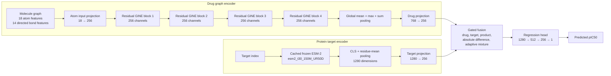

# v4.2 Drug–Target Interaction Architecture

This README documents the implemented v4.2 model architecture. It predicts pIC50 from a molecular graph and a protein target representation. The drug and target are encoded in separate branches, projected to a shared 256-dimensional space, combined through gated fusion, and passed to a regression head.

## Architecture overview

## Drug representation

Each molecule is represented as an atom-bond graph. Each atom receives an 18-dimensional feature vector: a 9-way atom-type encoding, a 6-way total-degree encoding, and a 3-way formal-charge-sign encoding.

Each chemical bond is represented as two directed edges. Each edge has a 14-dimensional feature vector containing:

- Five bond-type indicators: single, double, triple, aromatic, and dative
- Conjugation and ring-membership indicators
- Six stereo indicators: none, any, Z, E, cis, and trans
- A direction flag that identifies the donor-to-acceptor orientation of dative bonds

The atom features are projected from 18 to 256 dimensions and processed by four residual GINE convolution blocks. Each block incorporates bond features in message passing, applies a two-layer MLP, dropout, a residual connection, and LayerNorm. Graph-level mean, max, and sum pooling are concatenated and projected from 768 to a 256-dimensional drug vector.

The graph datasets must contain an aligned 14-dimensional `edge_attr` row for every directed edge. Graphs built without these bond features are incompatible with this model and must be regenerated before training or evaluation.

## Protein representation

The protein branch uses the frozen ESM-2 model `esm2_t30_150M_UR50D`. The final-layer CLS representation is concatenated with the mean of the residue representations to produce a 1,280-dimensional embedding. Embeddings are cached by target index and projected through a 1,280-to-256 layer, LayerNorm, and GELU. ESM-2 creates the fixed embeddings; its weights are not fine-tuned by v4.2 regression training.

## Gated drug–target fusion and prediction

Let `d` and `t` be the projected drug and target vectors. The fusion gate is computed from the drug vector, target vector, and their element-wise absolute difference:

`g = sigmoid(W [d, t, |d − t|] + b)`

The gate forms an adaptive mixture `g ⊙ d + (1 − g) ⊙ t`. The regression head receives the concatenation of `d`, `t`, the element-wise product `d ⊙ t`, `|d − t|`, and the adaptive mixture. This gives a 1,280-dimensional pair representation, which is mapped through 512- and 256-unit hidden layers to one pIC50 prediction.

## Training components associated with v4_2

Training uses Smooth L1 loss with pIC50-bin weights computed from training labels only. The bins use boundaries 4.5, 6, 7.5, 9, 10.5, and 12; inverse-square-root frequency weighting is capped at 5 before normalization. This increases the relative contribution of rare potency ranges without weighting validation or test metrics.

The model is optimized with AdamW (learning rate `5e-5`, weight decay `1e-4`), 10% linear warmup, and cosine decay. Training uses a target-ID-held-out validation set and early stopping on validation MAE. Checkpoint architecture revision is 7.

---

## Project file guide

This section describes every project file currently present in the repository's working tree, grouped by folder. It includes locally generated data, checkpoints, reports, and tests as well as source files. The `.git/` folder and the contents of `.venv/`, `venv/`, and `__pycache__/` are excluded: they are Git internals, installed third-party packages, or generated Python bytecode rather than project-authored files.

### Repository root

| File | Purpose |
|---|---|
| `.gitignore` | Excludes virtual environments, generated datasets, checkpoints, logs, and local settings from version control. |
| `README.md` | Description of the v4.2 architecture and this project file guide. |
| `RESEARCH_PAPER_DRAFT.md` | Concise research-paper-style draft describing the dataset, v4 model, evaluation results, and comparison with GraESM-FuseDTA. |
| `requirements.txt` | Python package requirements. Install a compatible CUDA-enabled PyTorch build separately before installing this file when GPU training is required. |

### `checkpoints/`

Saved model weights and training states. A checkpoint must be paired with the compatible model code, target index, and (where applicable) target embedding cache.

| File | Purpose |
|---|---|
| `.gitattributes` | Configures Git LFS handling for large `.pt` checkpoint files. |
| `dti_model_epoch10.pt` | Checkpoint from the original v1 experiment. |
| `dti_model_v2_final.pt` | Final saved checkpoint from the v2 experiment. |
| `dti_model_v3_stable_epoch15.pt` | Stable v3 checkpoint after the BatchNorm instability fix. |
| `dti_model_v4_best.pt` | Best checkpoint from the earlier v4 run, before the current GINE revision. |
| `dti_model_v4_last.pt` | Most recent training-state checkpoint from that earlier v4 run. |
| `dti_model_v4_gine_best.pt` | Best validation-MAE checkpoint for the current bond-aware GINE v4.2 architecture. |
| `dti_model_v4_gine_last.pt` | Last resumable training checkpoint for the current v4.2 run. |

### `data/`

Local data artifacts used to construct graphs and encode protein targets. Most are large or machine-specific and are excluded from Git.

| File | Purpose |
|---|---|
| `README(data).md` | Describes target lookup artifacts, graph formats, feature dimensions, and data rebuild instructions. |
| `target_to_idx.pkl` | Maps each UniProt accession to the integer target index stored in graph examples. |
| `target_sequences.pkl` | Protein sequence list indexed by `target_to_idx.pkl`; index ordering must stay aligned. |
| `esm2_t30_150M_cls_mean_embeddings.pt` | Cached frozen ESM-2 150M target embeddings (CLS plus residue mean) used by v4 training and evaluation. |
| `train_data_v2.pt` | Legacy training graph dataset without the v4 bond-feature matrix. |
| `train_data_v4.pt` | Rebuilt v4.2 training graphs with atom features, directed bond features, target indices, and pIC50 labels. |

`data/splits/` and raw BindingDB input files may also be created locally when preparing data; they are not included in the current project-file inventory.

### `evaluation/`

Serialized cold-start graph datasets are inputs to evaluation scripts; they are not prediction reports.

| File | Purpose |
|---|---|
| `README.md` | Explains the cold-start datasets, v2/v4 differences, sample counts, and where result reports are written. |
| `cold_drug_data_v2.pt` | Legacy cold-drug graphs for older models; no v4 bond features. |
| `cold_target_data_v2.pt` | Legacy cold-target graphs for older models; no v4 bond features. |
| `cold_pair_data_v2.pt` | Legacy cold-pair graphs for older models; no v4 bond features. |
| `cold_drug_data_v4.pt` | Current v4.2 cold-drug graphs, with required directed bond features. |
| `cold_target_data_v4.pt` | Current v4.2 cold-target graphs, with required directed bond features. |
| `cold_pair_data_v4.pt` | Current v4.2 strict cold-pair graphs, with required directed bond features. |

### `scripts/`

Scripts implementing data preparation, model training, and evaluation. The current v4_2 entry points use the `_v4_2.py` suffix.

**Naming note:** existing quick-start commands earlier in this README refer to the previous `scripts/train_v4.py`, `scripts/evaluate_v4.py`, and `scripts/build_graphs_v4.py` names. The current working tree contains `train_v4_2.py`, `evaluate_v4_2.py`, and `build_graphs_v4_2.py` instead. All v4_2 scripts import their helper modules using matching `_v4_2` names.

| File | Purpose |
|---|---|
| `prepare_splits.py` | Builds scaffold-based drug and grouped-target train/cold-start CSV splits, then checks for entity leakage. |
| `extend_target_index_v4_2.py` | Finds split UniProt IDs missing from the current target lookup, fetches their sequences, and appends both mapping and sequence entries while preserving existing indices. |
| `build_graphs_v4_2.py` | Converts the four split CSVs into PyTorch Geometric graph datasets with 18-dimensional atom features |
| `bond_features_v4_2.py` | Defines the 14 bond features, stereo encoding, and directed edge generation, including dative-bond direction. |
| `model_v4_2.py` | Defines the current model: residual GINE drug encoder, multi-pooling, frozen ESM embedding projection, gated fusion, and pIC50 regression head. |
| `loss_weighting_v4_2.py` | Assigns capped inverse-frequency weights to pIC50 bins for the training loss. |
| `metrics_v4.py` | Implements the concordance-index metric used alongside regression metrics. |
| `train_v4_2.py` | Main current training entry point: prepares/caches ESM embeddings, creates target-held-out validation, trains with weighted loss and warmup/cosine schedule, early-stops, and saves checkpoints. |
| `evaluate_v4_2.py` | Evaluates the selected v4_2 checkpoint on cold-drug, cold-target, and cold-pair datasets; writes reports, metrics, and prediction arrays. |
| `build_target_sequences.py` | Historical target mapping/sequence and embedding preparation utility. Inspect its settings before reuse; it contains environment-specific and notebook-oriented code. |
| `train_v2.py` | Historical v2 training implementation retained for reference/reproduction. |
| `train_v3.py` | Historical v3 training implementation using its live/task-adapted ESM pipeline. |
| `evaluate_v3.py` | Historical v3 evaluation entry point; its configuration contains the former `C:\DTI_GNN` project path and may need adaptation before use elsewhere. |

### `tests/`

Automated tests for core behaviors and regression protection.

| File | What it checks |
|---|---|
| `test_bond_features_v4.py` | Bond feature dimensions, bidirectional edges, and directed dative-bond encoding. |
| `test_extend_target_index.py` | Stable appending of missing targets and validation that sequence/index artifacts align. |
| `test_loss_weighting_v4.py` | pIC50 bin boundaries, stronger weights for rare bins, weight caps, and invalid-label handling. |
| `test_metrics_v4.py` | Concordance-index behavior for correct/reversed rankings, ties, and invalid inputs. |
| `test_model_v4.py` | Model forward/backward operation and rejection of malformed bond-feature inputs. |
| `test_model_v3.py` | Historical v3 target encoder behavior and graph-model forward/backward behavior. |
| `test_evaluate_v4_report.py` | v4 report/bin metric calculations and report-writing behavior. |
| `test_evaluate_train_sample_v3.py` | Historical v3 training-sample diagnostic sampling and stable graph-record identifiers. |

### `results/`

Previously generated evaluation outputs. Text/JSON reports summarize performance; CSV/NPZ files contain tabular or per-example outputs.

| File | Purpose |
|---|---|
| `version1/evaluation_report_v1.json` | Saved v1 evaluation metrics in JSON format. |
| `version2/evaluation_report_v2.txt` | Saved v2 cold-start metrics and pIC50-range breakdowns. |
| `version3/evaluation_report_v3.txt` | Saved stable-v3 cold-start metrics and pIC50-bin results. |
| `version4/evaluation_report_v4.1.txt` | Evaluation report for the earlier v4.1 checkpoint/run. |
| `version4/evaluation_report_v4_2.txt` | Current v4_2 cold-start report, including aggregate metrics and pIC50-bin breakdowns. |
| `version4/dti_model_v4_validation.csv` | Epoch-by-epoch validation history from the earlier v4 run. |
| `version4/dti_model_v4_gine_validation.csv` | Epoch-by-epoch validation history for the current GINE v4.2 run. |
| `version4/train_v4.log` | Captured v4 training log. |
| `version4/v4_summary_20261014_211342.csv` | Tabular aggregate metrics from an earlier v4 evaluation, with the run timestamp in its filename. |
| `version4/v4_predictions.npz` | Compressed NumPy arrays of predictions and reference labels from an evaluation run. |

### Local environment folders

- `.venv/` and `venv/` contain installed Python interpreters and third-party dependencies. They are machine-specific and intentionally not enumerated file-by-file.
- `__pycache__/` folders contain generated Python bytecode and can be recreated by Python.
- `.git/` contains repository history and internal metadata, not application source.
