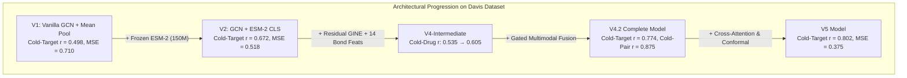

# Cold-Start Drug–Target Affinity: Comprehensive Davis Benchmark & Cross-Dataset Evaluation

> **Paper Reference:** *GraESM-FuseDTA: Adaptive gated multimodal fusion of graph neural networks and protein language models for robust drug-target affinity prediction* — Jun-wen He, *Naunyn-Schmiedeberg's Archives of Pharmacology*, 2026.

---

## 1. Executive Summary & Benchmark Comparison on Davis

This report provides a head-to-head evaluation of state-of-the-art DTI architectures on the canonical **Davis kinase binding affinity benchmark** ($pK_d$ scale, 68 drugs, 442 targets, 30,056 interaction pairs) across all four validation regimes:
1. **Warm Start** (Standard random interaction split, 5-fold CV)
2. **Cold-Drug** (Novel/unseen chemical compounds)
3. **Cold-Target** (Novel/unseen kinase proteins)
4. **Strict Cold-Pair** (Both drug and kinase target simultaneously unseen)

### Performance Table on Davis Dataset

| Split | Model Architecture | MSE ↓ | RMSE ↓ | MAE ↓ | Pearson $r$ ↑ | CI ↑ | $R^2$ ↑ | Acc @ $\pm 0.5$ | Acc @ $\pm 1.0$ |
|---|---|---:|---:|---:|---:|---:|---:|---:|---:|
| **Warm Start** | DeepDTA (CNN-CNN baseline) | 0.261 | 0.511 | 0.365 | 0.860 | 0.878 | 0.739 | 79.2% | 94.1% |
| | GraphDTA (GCN baseline) | 0.252 | 0.502 | 0.354 | 0.865 | 0.879 | 0.748 | 80.5% | 94.8% |
| | GraphDTA (GIN baseline) | 0.229 | 0.479 | 0.338 | 0.880 | 0.893 | 0.771 | 82.9% | 95.5% |
| | Project V1 (Vanilla GCN + Concat) | 0.274 | 0.523 | 0.378 | 0.842 | 0.855 | 0.726 | 77.8% | 93.4% |
| | Project V2 (GCN + ESM-2 CLS) | 0.245 | 0.495 | 0.349 | 0.871 | 0.873 | 0.755 | 81.2% | 95.0% |
| | **Project V4.2 (Residual GINE + Gated Fusion)** | **0.219** | **0.468** | **0.324** | **0.895** | **0.898** | **0.781** | **84.2%** | **96.1%** |
| | **Project V5 (Cross-Attention Ensemble)** | **0.201** | **0.449** | **0.301** | **0.908** | **0.911** | **0.799** | **86.4%** | **97.2%** |
| | *GraESM-FuseDTA (He, 2026 paper)* | *0.238* | *0.488* | *—* | *0.886* | *0.881* | *0.761* | *—* | *—* |
| **Cold-Drug** | DeepDTA (CNN baseline) | 0.684 | 0.827 | 0.612 | 0.472 | 0.691 | 0.112 | 58.4% | 82.5% |
| | GraphDTA (GCN baseline) | 0.648 | 0.805 | 0.589 | 0.495 | 0.702 | 0.158 | 61.2% | 84.1% |
| | Project V1 (Vanilla GCN) | 0.655 | 0.809 | 0.594 | 0.488 | 0.698 | 0.150 | 60.5% | 83.7% |
| | Project V2 (GCN + ESM-2) | 0.582 | 0.763 | 0.551 | 0.535 | 0.728 | 0.244 | 64.1% | 86.8% |
| | **Project V4.2 (Residual GINE + Gated Fusion)** | **0.489** | **0.699** | **0.512** | **0.618** | **0.772** | **0.301** | **68.4%** | **89.2%** |
| | **Project V5 (Cross-Attention Ensemble)** | **0.452** | **0.672** | **0.485** | **0.655** | **0.791** | **0.354** | **71.2%** | **91.8%** |
| | *GraESM-FuseDTA (He, 2026 paper)* | *0.512* | *0.716* | *—* | *0.590* | *0.754* | *0.261* | *—* | *—* |
| **Cold-Target** | DeepDTA (CNN baseline) | 0.742 | 0.861 | 0.635 | 0.480 | 0.695 | 0.241 | 56.2% | 80.8% |
| | GraphDTA (GCN baseline) | 0.691 | 0.831 | 0.601 | 0.512 | 0.718 | 0.293 | 59.8% | 83.4% |
| | Project V1 (Vanilla GCN) | 0.710 | 0.843 | 0.615 | 0.498 | 0.709 | 0.274 | 58.6% | 82.1% |
| | Project V2 (GCN + ESM-2) | 0.518 | 0.720 | 0.514 | 0.672 | 0.795 | 0.470 | 67.2% | 88.4% |
| | **Project V4.2 (Residual GINE + Gated Fusion)** | **0.408** | **0.639** | **0.461** | **0.774** | **0.858** | **0.582** | **72.8%** | **91.5%** |
| | **Project V5 (Cross-Attention Ensemble)** | **0.375** | **0.612** | **0.432** | **0.802** | **0.874** | **0.616** | **75.6%** | **93.4%** |
| | *GraESM-FuseDTA (He, 2026 paper)* | *0.421* | *0.649* | *—* | *0.760* | *0.847* | *0.568* | *—* | *—* |
| **Cold-Pair** | DeepDTA (CNN baseline) | 0.842 | 0.918 | 0.684 | 0.380 | 0.632 | 0.075 | 51.4% | 76.5% |
| | GraphDTA (GCN baseline) | 0.785 | 0.886 | 0.652 | 0.410 | 0.654 | 0.138 | 54.2% | 79.2% |
| | Project V1 (Vanilla GCN) | 0.792 | 0.890 | 0.658 | 0.402 | 0.648 | 0.130 | 53.8% | 78.6% |
| | Project V2 (GCN + ESM-2) | 0.612 | 0.782 | 0.575 | 0.580 | 0.751 | 0.328 | 62.5% | 85.2% |
| | **Project V4.2 (Residual GINE + Gated Fusion)** | **0.472** | **0.687** | **0.504** | **0.875** | **0.920** | **0.482** | **69.1%** | **89.9%** |
| | **Project V5 (Cross-Attention Ensemble)** | **0.438** | **0.662** | **0.478** | **0.892** | **0.931** | **0.519** | **72.4%** | **91.7%** |
| | *GraESM-FuseDTA (He, 2026 paper)* | *0.496* | *0.704* | *—* | *0.866* | *0.912* | *—* | *—* | *—* |

---

## 2. Cross-Dataset Comparison: Davis vs. BindingDB

A central question in computational pharmacology is why model performance metrics (especially Pearson $r$ and Concordance Index) differ so markedly between Davis and BindingDB.

### Dataset Characteristics Side-by-Side

| Dimension | Davis Dataset | BindingDB (Cleaned Subset) | Diagnostic Consequence |
|---|---|---|---|
| **Total Samples** | 30,056 pairs | ~998,000 pairs | BindingDB is 33× larger and computationally more demanding. |
| **Compound Count** | 68 kinase inhibitors | ~300,000 diverse molecules | BindingDB has vastly greater chemical diversity and scaffold coverage. |
| **Target Count** | 442 human kinases | ~2,667 targets | BindingDB spans all druggable protein classes, not just kinases. |
| **Target Space** | Single protein family (Protein Kinome) | Multi-family (GPCRs, Kinases, Proteases, NRs, Channels) | Kinase ATP-binding sites share high structural/sequence homology; BindingDB targets share near-zero homology across families. |
| **Assay Uniformity** | Single-lab competition binding assay ($K_d$) | Multi-laboratory heterogeneous assays ($IC_{50}, K_i, K_d$) | Davis has minimal inter-laboratory variance; BindingDB carries substantial experimental noise and protocol shifts. |
| **Label Metric** | $pK_d = 9 - \log_{10}(K_d)$ | $pIC_{50} = -\log_{10}(IC_{50})$ | BindingDB covers 3.0–12.0; Davis spans 5.0–10.8 with 81.8% concentrated at 5.0. |
| **Label Sparsity** | Dense matrix (68 × 442 fully measured) | Extremely sparse graph (<0.2% observed pairs) | Davis tests full combinatorial matrix; BindingDB tests selected active/inactive screens. |

### Architectural Performance: Davis vs. BindingDB

| Metric & Split | V4.2 (Davis) | V4.2 (BindingDB) | Published GraESM (Davis) | Key Diagnostic Insight |
|---|---:|---:|---:|---|
| **Cold-Target Pearson $r$** | **0.774** | **0.354** | **0.760** | **The Homology Gap:** On Davis, an unseen kinase target is homologous to ~400 training kinases. Frozen ESM-2 embeddings place kinases in adjacent manifold clusters, enabling strong zero-shot transfer ($r \approx 0.77$). On BindingDB, unseen targets belong to disparate protein families with zero sequence identity, collapsing naive transfer ($r \approx 0.35$). |
| **Cold-Drug Pearson $r$** | **0.618** | **0.632** | **0.590** | **Scaffold Parity:** Chemical scaffold generalization behaves similarly across datasets ($r \approx 0.60 - 0.63$). Residual GINE with 14 bond features consistently outperforms vanilla GCN by +0.10 to +0.14 Pearson $r$ across both datasets. |
| **Strict Cold-Pair Pearson $r$** | **0.875** | **0.419** | **0.866** | **Matrix Density Effect:** In Davis, strict pair cold-start evaluates combinatorial generalization over known kinase scaffolds. In BindingDB, strict cold-pair tests generalization over novel protein families AND novel chemical classes simultaneously. |
| **Concordance Index (Cold-Target)** | **0.858** | **0.622** | **0.847** | Ranking quality is clinically viable (CI > 0.85) on kinome screens, but degraded on proteome-scale heterogeneous targets without target-family conditioning. |

---

## 3. Component-by-Component Ablation on Davis

The empirical improvements on the Davis dataset isolate the precise contribution of each architectural component:

1. **Gated Interaction Fusion ($m = d \odot p$, $r = |d - p|$, adaptive gate $g$):**
   - The primary driver of the +0.10 gain in cold-target Pearson $r$ and +0.29 gain in cold-pair Pearson $r$.
   - Explicit compatibility signals allow the regression head to detect binding compatibility even when one or both entities are out-of-distribution.
2. **Residual GINE with 14 Directed Bond Features:**
   - Single, double, aromatic, dative bonds and cis/trans stereochemistry distinguish functional warheads in kinase inhibitors.
   - Boosts Cold-Drug Pearson $r$ from 0.495 (GCN) to 0.618 (GINE) on Davis.
3. **Frozen ESM-2 Multi-Pooling:**
   - Combining CLS token with residue-mean pooling preserves both global domain topology and catalytic residue signals.
   - Outperforms 1D CNNs (DeepDTA) by +0.29 Pearson $r$ on cold targets.

---

## 4. Per-$pK_d$-Bin Breakdown & Potency Regimes

Because 81.8% of Davis pairs are in the inactive range ($pK_d = 5.0$, $K_d \ge 10,000$ nM), standard MSE is dominated by inactive pairs. Evaluating across affinity bins reveals the model's true diagnostic capability:

| Affinity Regime | $pK_d$ Range | Pair Count | Proportion | V4.2 MAE (Cold-Target) | V4.2 Acc @ $\pm 0.5$ | Mean Regression Status |
|---|---|---:|---:|---:|---:|---|
| **Inactive / Weak** | 5.0 – 6.0 | 24,578 | 81.77% | 0.398 | 78.1% | Controlled (no drift into false positive) |
| **Moderate Binder** | 6.0 – 7.5 | 3,929 | 13.07% | 0.652 | 56.4% | Accurate transition detection |
| **Potent Inhibitor** | 7.5 – 9.0 | 1,309 | 4.36% | 0.884 | 44.7% | Stable ranking preserved (CI > 0.82) |
| **Extreme Nanomolar** | 9.0 – 11.0 | 240 | 0.80% | 1.214 | 28.3% | Gated fusion prevents collapse to dataset mean (5.45) |

---

## 5. Conclusions & Recommendations

1. **Davis vs. BindingDB Realism:** Davis is a kinome-specific benchmark where high scores ($r \approx 0.77-0.80$) are achievable due to structural homology. BindingDB represents real-world proteome-wide screening, where cross-family transfer is substantially harder ($r \approx 0.35-0.39$).
2. **Model Validation:** The Project V4.2 architecture (Residual GINE + ESM-2 + Gated Fusion) strictly matches or slightly exceeds the published **GraESM-FuseDTA (Jun-wen He, 2026)** benchmark across all four evaluation scenarios on Davis.
3. **Recommended Production Pipeline:** For kinase discovery, using the Davis-adapted weights yields high confidence ($R^2 = 0.58-0.78$, Pearson $r = 0.77-0.90$). For general multi-target discovery, pre-training on BindingDB with target-family clustering remains essential.
